# mermaid-design

[English](README.md) | 日本語

設計意図を伝えるMermaid図を作り、同じ原稿からSVG・PNGへ出力するエージェント用スキルです。フローチャート、システム構成、状態、時系列、データ関係を扱います。

エージェントは、構文が正しいか、画像を読み取れるか、原資料の事実と一致するかを確認します。ローカルのツールが配置候補、図形の診断、確認画像、ハッシュを生成し、意味と見た目はエージェントが確認します。

## 導入

Node.js 24.22.1 LTS（`.nvmrc`）、npm 11.19.1、Chromiumブラウザを用意してください。`engine-strict`により、対応範囲外のNode.js・npmでは依存関係を導入できません。リポジトリ全体をエージェントのスキルディレクトリへ`mermaid-design`として配置するか、[SKILL.md](SKILL.md)を読み込むよう設定します。スクリプトとpackageファイルも同じ場所に置きます。

リポジトリのディレクトリで実行します。

```sh
npm run setup
npm exec --prefix .runtime -- playwright install chromium
```

固定した実行用依存関係だけを`.runtime/`へ導入します。Chromiumが導入済みなら2行目は不要です。実行ファイルを`--browser`または環境変数`MERMAID_BROWSER`で指定できます。依存関係の更新後は`npm run setup`を再実行してください。描画ツールは古い導入済みバージョンを拒否します。通常の開発用配置を更新する場合は`npm ci`を使います。

描画の依存関係はMermaid 12.2.0、Playwright 1.64.1、YAML 2.9.1に固定しています。nvmによる環境設定と検証コマンドは[開発](#開発)を参照してください。

## 使い方

ファイル読取・シェル実行・画像確認ができるエージェントへ依頼します。

> mermaid-designを使い、渡した事実を図にしてください。Mermaid原稿、SVG、PNG、意味と読みやすさについての短い確認記録を納品してください。

新規作成と既存図の変更に使えます。エージェントがスキルを読み、図式を選び、実際に描画した画像を見て、原資料との一致を確認します。

描画ツールは直接実行することもできます。

```sh
node scripts/diagram.cjs review docs/architecture.mmd --out-dir output --improve
node scripts/diagram.cjs verify output/architecture.render.json
```

`review --improve`は3種類の配置設定を比較し、選んだSVG、PNG、閲覧幅の確認画像、`.render.json`を出力します。大きな図は全体画像と重なりのある詳細画像に分かれる場合があります。`verify`は記録された原稿・生成物のハッシュを照合し、保存済みの環境と設定ハッシュを返します。再描画や意味・見た目の合格判定は行いません。

方向が意味を持たない新規フローチャートでは、`drafts --presentation-only`で元原稿を変更せずにLR・TB・BTの候補を作れます。画像を確認してから候補を選びます。具体的な操作と確認要件は[スキル](SKILL.md)を参照してください。

## アーキテクチャ



| 構成要素                                   | 機能                                                 |
| ------------------------------------------ | ---------------------------------------------------- |
| `SKILL.md`                                 | 関係・境界・図式・確認についてのエージェント向け指示 |
| `scripts/diagram.cjs`                      | 原稿候補、一括描画、出力、ハッシュ照合               |
| `scripts/audit.cjs`                        | ブラウザ内での図形診断                               |
| `scripts/setup.cjs`、`scripts/runtime.cjs` | 固定依存関係の導入と読込                             |
| `.mmd`、`.svg`、`.png`、`.render.json`     | 原稿、画像、生成元の記録                             |

描画はローカルで実行し、ブラウザのネットワーク要求を遮断します。原稿を変えた図は生成物を作り直します。確認記録を引き継げるのは、事実・原稿・環境・設定・生成物が一致する場合です。意味・見た目の自動承認フラグは`false`のままにし、実施した確認を別の記録へ残します。

## 定量比較

2026年10月24日（日本時間）に、新規作成2件・局所変更2件・意味修正1件の架空の5例題を測定しました。各試行は新しいエージェントの文脈で実行しました。スキルなし側は通常のMermaid知識と単純な描画ヘルパー、あり側はこの英語版スキルとCLIを使いました。モデル、依存関係、ブラウザ、例題の本文、納品要件、画像確認ツールは共通です。

| 例題               | なし：トークン | あり：トークン | なし：実行秒 | あり：実行秒 |
| ------------------ | -------------: | -------------: | -----------: | -----------: |
| 構成図の新規作成   |        363,152 |        245,913 |         95.2 |        135.2 |
| 時系列図の新規作成 |        626,828 |        334,085 |        156.3 |        126.1 |
| 構成図の局所変更   |        899,259 |        226,261 |        227.0 |         91.0 |
| 時系列図の局所変更 |        462,670 |        509,688 |        104.6 |        192.3 |
| 独立属性の意味修正 |        481,706 |        389,004 |        151.1 |        163.5 |

5組の合計は、実トークン数が2,833,615から1,704,951へ39.8%減、実行時間が734.2秒から708.1秒へ3.6%減でした。モデルからのツール呼出しは53回から29回になりました。スキルあり5試行の合計1,704,951トークンは、受入条件の2,000,000以内です。

手法名を伏せた別のレビュアーは、スキルありの全成果物を、構文・視覚・意味の各項目で4/4と評価しました。修正後の得点で、対応するスキルなし側より下がった項目はありません。初回評価では両手法の時系列図に1件ずつ、縦線とメッセージ文字の重なりがありました。同じ作成者が修正し、継続分の全トークンと実行時間を含めています。初回の評価と該当する生成物も保存しています。最終ソース・出力のハッシュと、作成者・レビュアーが実際に読み込んだ画像も照合しました。

トークン数は実行環境が報告した入力と出力の合計で、キャッシュ済み入力も入力の内数として一度含めます。実行時間は各ターンの所要時間の合計で、ツール待ち・復旧可能な失敗・品質評価後の修正を含みます。ターン間の調整待ちを含む経過時間はデータに別記しています。実行時間の合計には、環境構築・開発・調整・独立レビュー・試行間の待ち時間を含めません。全10試行は中断・置換なしで完了しました。

1つのモデル・実行環境で5例題を各手法1回ずつ測った結果であり、一般的な高速化率や人による品質同等性を保証するものではありません。

方法・例題・実カウンター・品質評価・出力例は[ベンチマーク](benchmarks/README.md)にあります。合計値を再計算できます：

```sh
node benchmarks/summarize.cjs
```

## 開発

`.nvmrc`で指定したNode.js 24.22.1 LTSとnpm 11.19.1を使います。開発用の依存関係は通常のnpm配置へ導入します。

```sh
nvm install
nvm use
npm ci
npm exec -- playwright install chromium
npm run check
```

`npm ci`ではライフサイクルスクリプトを有効にしてください。`prepare`がHuskyのフックを導入します。

| コマンド               | 検証内容                                             |
| ---------------------- | ---------------------------------------------------- |
| `npm run lint`         | ESLint。警告も失敗として扱う                         |
| `npm run format:check` | Prettierの書式                                       |
| `npm run test:unit`    | Chromiumを使わない単体・実行環境のテスト             |
| `npm run test:browser` | ブラウザでの描画と画像の検証                         |
| `npm test`             | Vitestの全テスト                                     |
| `npm run check:fast`   | lint、書式、単体・実行環境のテスト                   |
| `npm run check`        | 高速な検証、ブラウザテスト、ベンチマーク集計値の検証 |

Vitestでは単体・実行環境の17テストと、5図種別・7例題を対象とするブラウザ統合テストを実行します。原稿保持、不正入力、生成物の改ざん、古い出力、図形の問題、PNGの網羅性と一致を検証します。生成される全27枚のPNGを、独立したSVG DOMの描画と比較します。

Huskyはコミット前に`check:fast`、プッシュ前に`check`を実行します。ローカルのフックは回避でき、サーバー側の必須CIチェックやGitHub Actionsのワークフローはありません。

設定がデフォルトブランチに入ると、Dependabotはnpm更新のプルリクエストを毎週作成し、開発用依存関係のminor・patch更新をまとめます。自動マージは行いません。Botのプルリクエストではローカルのフックが動かないため、メンテナーが各プルリクエストをチェックアウトし、マージ前にローカルで`npm ci && npm run check`を実行してください。

## ライセンス

[MIT](LICENSE)。依存パッケージにはそれぞれのライセンスが適用されます。
