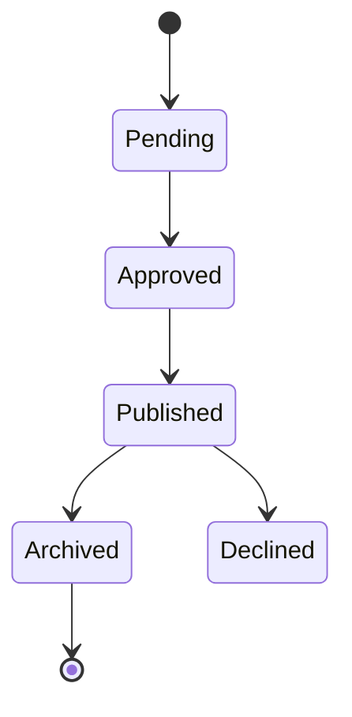

# Synthetic independent attributes

Repair the supplied diagram so it answers: what values can a record hold, and what is required to publish it? Choose a representation that preserves exactly these facts:

- A record has an independent review attribute with values pending, approved, and declined.
- The same record has an independent publication attribute with values draft, published, and archived.
- Publishing requires the review attribute to be approved at the instant publishing occurs.
- After publication the review attribute may change.
- Attribute value lists do not specify transition rules, an initial state, or a final state.
- Approval alone does not imply automatic publication or permission sufficient for publication.

The supplied source incorrectly combines independent attributes into a state chain:

Replace this representation as needed. Do not invent a sequence of attribute transitions, combine the two attributes into one mutually exclusive state, or assert that a published record must remain approved.

Save diagram.mmd, diagram.svg, the necessary PNG exports, and a short review.md in output/. Check syntax by rendering, view the actual exported images for readability, and check that the diagram conveys these constraints without additional claims.
