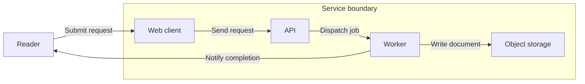

# Synthetic storage label update

Update the supplied Mermaid flowchart for a terminology change. Object storage is now called Blob store. Change the displayed node name and the corresponding write-action label to "Store in Blob store". Preserve every node identifier, boundary membership, arrow direction, and other relationship or label. Layout direction has no semantic axis.

Existing source:

Save the updated diagram.mmd, diagram.svg, necessary PNG exports, and a short review.md in output/. Render to check syntax, view the actual exported images for readability, and verify the requested change and all preserved relationships. Do not add facts or relationships.
