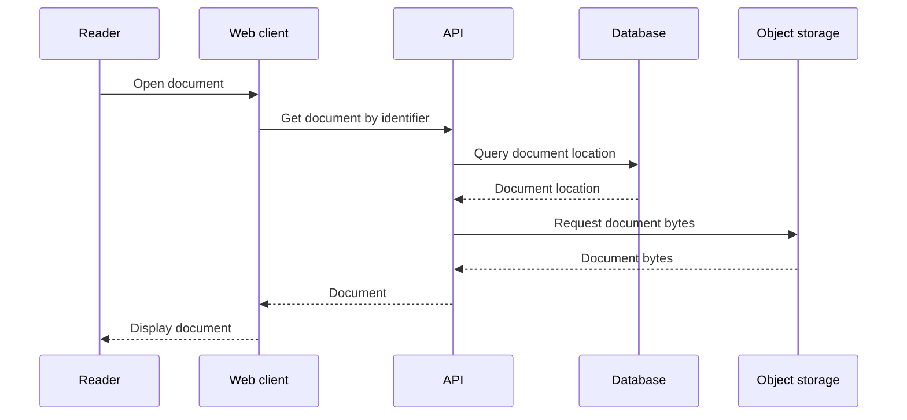

# Synthetic response label update

Update the supplied Mermaid sequence diagram. The Database response label must say "Download location" instead of "Document location". This is the only semantic change. Preserve participant identifiers and order, all eight interactions, their order, their endpoints, and whether each arrow denotes a call or a response. Do not add interactions.

Existing source:

Save the updated diagram.mmd, diagram.svg, necessary PNG exports, and a short review.md in output/. Render to check syntax, view the actual exported images for readability, and check the requested edit and every preserved interaction against the source.
